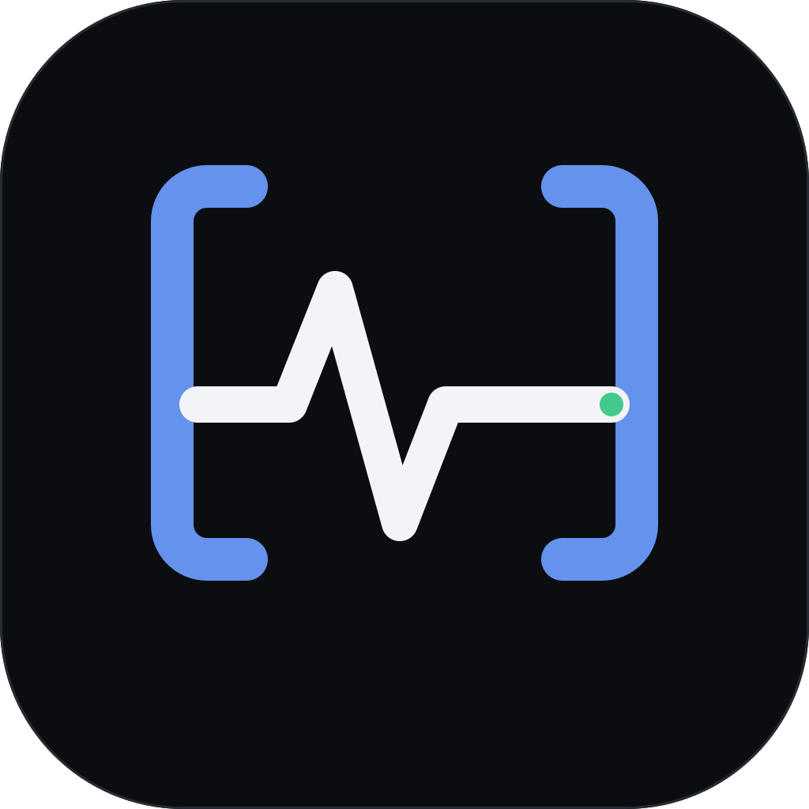
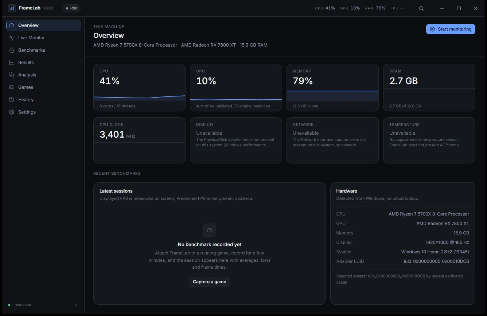
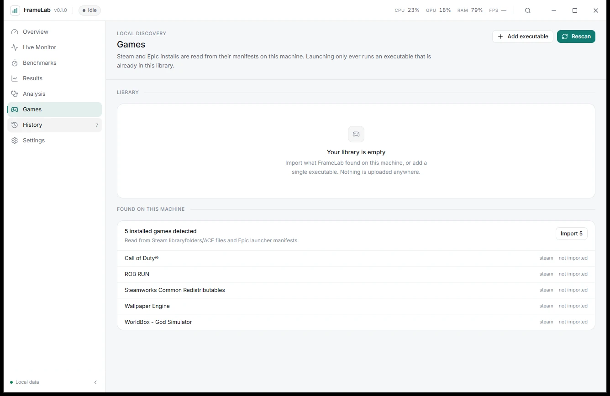

<div align="center">



# FrameLab

**Find the frame that made your game hitch.**

Record a run, line up frame times with CPU and GPU activity, and see the spikes an average FPS can hide. Your recordings stay on your PC.

[](https://github.com/zenou101/framelab/releases/latest)
[](https://github.com/zenou101/framelab/actions/workflows/ci.yml)

[](LICENSE)

[**Download FrameLab**](https://github.com/zenou101/framelab/releases/latest) · [Website](https://zenou101.github.io/framelab/) · [First benchmark](#record-your-first-benchmark) · [Build from source](#build-from-source)

</div>

| System overview | Games library |
| :---: | :---: |
| [](site/public/screenshots/overview-dark.webp) | [](site/public/screenshots/games-light.webp) |

*Captured in FrameLab 0.1.0 on Windows 10 22H2. Later releases also detect Xbox app and Microsoft Store games.*

## Installation

Choose a Windows x64 package from the [latest release](https://github.com/zenou101/framelab/releases/latest).

| Package | How to run it | Recordings and settings |
| --- | --- | --- |
| **Installer** `x64-setup.exe` | Run the per-user installer. Installation does not require administrator rights. | `%APPDATA%\app.framelab.desktop` |
| **Portable** `x64-portable.zip` | Extract the ZIP and open `framelab.exe`. | The `data` folder beside the executable |

FrameLab is an early development preview. Features and stored data formats may change. Builds are unsigned, so Windows SmartScreen may show an unknown-publisher warning.

## Record your first benchmark

1. Start your game and open **Benchmarks** in FrameLab.
2. Select the game's **Running process**, then choose **Attach capture**. Selecting a library entry is optional.
3. Choose **Record benchmark**, play the section you want to measure, then select **Stop and save**.
4. Open the frame-time chart in **Results** to find the hitch. **History** lets you reopen the session or export it as CSV or JSON.

## What it does today

In **Results**, the frame-time trace and system activity are sampled on the same clock. If you felt a hitch during the run, start with the tallest spike and check what else changed at that point.

| Measurement | What it tells you |
| --- | --- |
| **Displayed and presented FPS** | PresentMon tracks frames that reached the screen separately from frames the game submitted. FrameLab keeps both series so you can see when they diverge. |
| **Frame time** | Each point measures an interval in milliseconds. A spike marks a longer wait between frames, even when the average FPS looks steady. |
| **1% and 0.1% lows** | FrameLab converts the mean frame time of the slowest 1% or 0.1% into FPS. The figures appear after 300 and 1,000 valid frames respectively. |
| **System activity** | CPU load and clocks, GPU and VRAM use, memory, disk and network activity give a spike context. Missing counters are labelled unavailable. |

**Games** scans local Steam, Epic, Xbox app and Microsoft Store installations, including installed PC Game Pass titles. You can also add an executable manually. **Analysis** flags patterns such as clustered spikes or memory pressure for you to investigate.

## System requirements

| Component | Requirement |
| --- | --- |
| Operating system | Windows 10 22H2 or Windows 11, x64 |
| Graphics and memory | DirectX 12-capable GPU with current drivers and at least 8 GB RAM (16 GB recommended) |
| Storage | Around 250 MB for the app, plus roughly 1–2 MB per recorded minute |
| Runtime | Microsoft Edge WebView2 Evergreen. The installer can fetch it if needed. |
| Capture permissions | PresentMon uses Event Tracing for Windows (ETW). Some systems require elevation or membership in **Performance Log Users**. |

## Limitations

FrameLab has been exercised on Windows 10 22H2 with an AMD GPU. Counter accuracy and availability depend on the driver and Windows configuration, particularly on hybrid laptops, virtual machines, remote desktops and systems with hardware-accelerated GPU scheduling. Temperature readings require a supported sensor source.

Capture needs a running process and a presentation API supported by PresentMon. Protected games may restrict monitoring. Follow the game's terms. FrameLab has no in-game overlay. Stutter counts and analysis describe the recording and cannot establish the cause of a hitch.

## Build from source

On Windows x64, install Node.js 22 LTS (latest patch) with npm, stable Rust with the `x86_64-pc-windows-msvc` toolchain, and Visual Studio Build Tools with **Desktop development with C++**.

```powershell
git clone https://github.com/zenou101/framelab.git
cd framelab
npm ci
npm run tauri dev
```

To produce the installer, run `npm run tauri build`. The NSIS installer is written to `src-tauri/target/release/bundle/nsis/`. FrameLab bundles PresentMon and checks its SHA-256 hash before running it.

## Privacy

Monitoring, capture and export work offline. FrameLab saves frames and system samples to SQLite in chunks, so an interrupted recording retains the data already written. The app has no accounts, cloud sync or telemetry. See the [privacy policy](PRIVACY.md) for file locations, retention and WebView2 behaviour.

## Licence

FrameLab uses the [MIT licence](LICENSE). Intel PresentMon, Inter and other bundled components retain their own licences. See the [third-party notices](THIRD_PARTY_NOTICES.md). FrameLab is provided as is, and its measurements are informational. The [full disclaimer](DISCLAIMER.md) covers warranties and applicable consumer rights.

For the landing page's build and deployment instructions, see the [website README](site/README.md).

[Report a bug or request a feature](https://github.com/zenou101/framelab/issues). For a security issue, [email the maintainer privately](mailto:nuxxzul@gmail.com).
